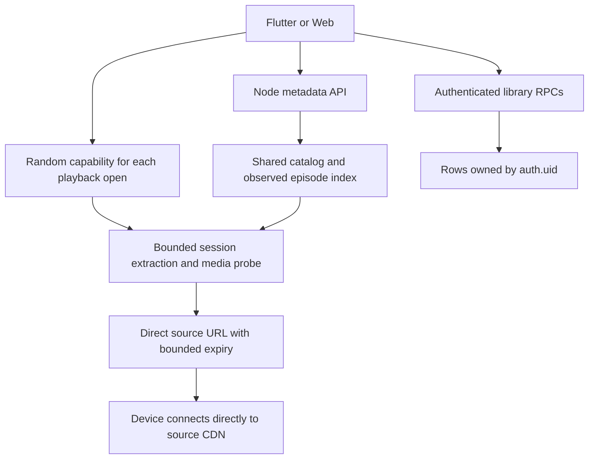

# Current runtime and data flow

Najd and Beta have separate registries, configurations and source catalogs. Provider IDs and observed episode references are preserved; UI numbering is not a replacement for source identity. TMDB supplies confirmed catalog metadata and is not authority to invent missing source episodes.

Library favorites, progress and history are private. Consent links authorize handoff between accounts, while each account keeps its own rows and local snapshot. Shared favorite harvesting updates work/episode metadata only.

Playback credentials are extracted for each open. Polling reuses only its random capability; another open/account cannot replace that session's cache entry. Credential renewal does not invalidate another viewer's episode. HTTP limits govern extraction/probing; video bytes and HLS Range/206 requests travel directly between the device and CDN. See `../PLAYBACK_ISOLATION.md` for boundaries and tests.

Hourly harvesting is durable in pg_cron with leases, bounded cleanup and a transaction lock. See `../../supabase/README.md`. An unavailable source stays explicit; Laroza uses the directly reviewed laroza1.site origin.

Current build/release inputs are in `BUILD_AND_CODE_REFERENCE.md`. The source test suite cannot establish upstream simultaneous-stream policy, hardware buffering performance or device signing.
