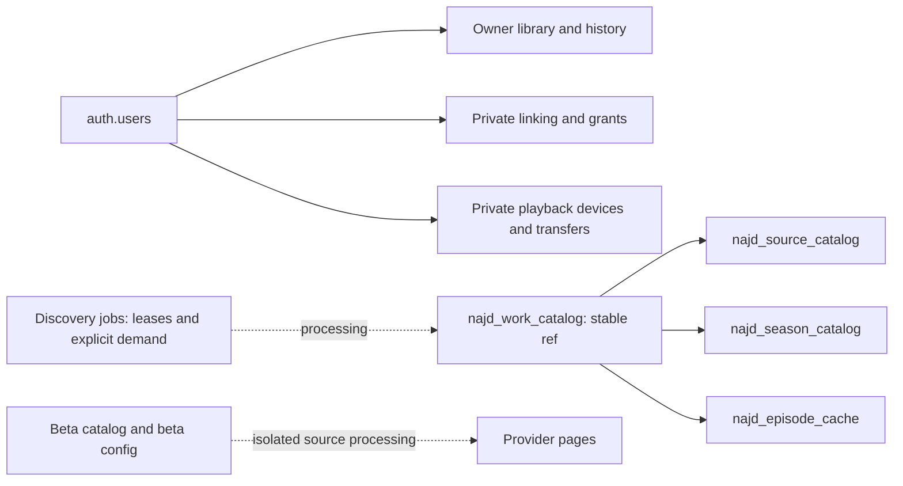

# NajdTV v4 database review and execution checkpoint

Date: 2026-11-07. Target application release: v4.0.1, not published at this checkpoint.

## Applied and verified database changes

Migration: `supabase/migrations/20261107230635_najd_v4_schema_performance.sql`.

- Added covering indexes for `mitv_private.najd_links.receiver_id` and `mitv_private.najd_playback_transfers.owner_id`.
- Optimized eight legacy favorite/history owner policies using `(select auth.uid())`, preserving the existing role scopes and both UPDATE ownership checks.
- Added explanatory schema/table comments, without changing compatibility table names, user identifiers, stored library rows, or RPC contracts.
- Verification returned `added_indexes=2` and `optimized_policies=8`.
- A transaction using the authenticated role and a synthetic subject verified that favorite/history queries exposed no other owner's rows; the transaction was rolled back.
- Performance advisors after the migration no longer reported unindexed foreign keys or auth RLS initPlan issues. Seven unused-index notices remain; indexes were not dropped on the basis of a short observation window.
- All inspected public application tables have RLS enabled. Sixteen Najd SECURITY DEFINER RPCs mention an auth/owner check and use an empty search_path; this metadata check alone does not prove their entire business logic. Their deliberate availability is required for linking and cloud synchronization, so execute grants were not blindly revoked.

## Schema map

Names beginning `mitv` or `matv` remain compatibility identifiers. Domain names and UI branding do not require renaming persistent data.

| Area | Tables | Responsibility |
|---|---|---|
| Identity and personal data | `najd_profiles`, `mitv_devices`, `mitv_library`, legacy `mitv_favorites` and `mitv_watch_history` | Owner-scoped profiles, synchronized library and watch checkpoints |
| Linking | private `najd_links`, `najd_library_grants`, `najd_link_attempts`, `najd_account_activity` | Short-lived invitations, explicit grants, bounded attempts and activity |
| Playback handoff | private `najd_playback_devices`, `najd_playback_transfers` | Linked receiver discovery, expiring playback messages and acknowledgments |
| Shared catalog | `najd_work_catalog`, `najd_source_catalog`, `najd_season_catalog`, `najd_episode_cache` | Stable work references, provider editions, observed seasons/episodes and expiring media |
| Scheduling | `matv_discovery_jobs`, `matv_content_demand`, `najd_harvest_events` | Durable jobs, leases, explicit demand and diagnostics |
| Independent beta | `najd_beta_catalog`, `najd_beta_provider_config` | Beta metadata/config isolated from Najd's parser state |
| Najd configuration | `najd_provider_config`, `najd_provider_registry` | Validated domains/search configuration and public provider identifiers |
| Other metadata caches | `matv_provider_cache`, `matv_provider_events`, `mitv_catalog_cache`, `mitv_catalog_feed_cache`, `mitv_work_activity` | Bounded metadata caching and activity; not personal library ownership |

Solid catalog/user arrows correspond to inspected foreign-key relationships. The dotted processing arrows are logical flows, not asserted foreign keys.

## Pressure snapshot and boundaries

At the observed point there were about 456k episode-cache rows and 203k discovery jobs, including about 190k queued, with one active database session and nine idle sessions. Counts and storage estimates change and are not CPU measurements. The queued backlog was not arbitrarily deleted. Existing retention jobs and bounded demand-driven workers must be checked separately before increasing background work.

Do not confuse a media URL's expiry with removal of its episode identity. Keep service-only catalog caches separate from owner RLS rows. Retain explicit episode references and every dubbed/subtitled edition rather than borrowing TMDB numbering.

## Application work checkpoint — incomplete

Local worktree `/workspace/najd-v4`, branch `build/najd-v4`, based on `7d45799bf1b7a101eff53386e0f1337338d1b287`.

Written locally before the runtime disconnected: seek burst helper; bottom toolbar layout and clock badges; LTR vertical sliders and adaptive rails; quick tools and three quality policies; direct-container format/signature helpers; responsive infinite carousel; filtering technical category IDs from displayed genres; scroll-to-top overlay; actor sorting/year filter and popularity metadata; lazy home shelves; 108 validated TMDB filter policies; observed domain updates for 3ckTV, Moviz Time, 5TV and WitAnime.

These application edits are not included in this database-only branch, are not yet fully tested, and were not published. Last analyze check before the final shelf edits reported three style issues. New schema migration and this checkpoint are preserved remotely even though the execution environment became unavailable. The attempted new `3iskk` parser/registry write failed at exec transport startup; its existence must be checked on recovery, not assumed.

Observed source checks used the app's guarded HTTP transport: 3ckTV e.3cktv.com, Moviz Time moviz-time.surf, 3iskk.xyz and the 5TV user alias returned actual content. `ww4.3ick.club` redirected to `3iskk.xyz`, so it is an alias rather than another independent source. WitAnime returned ACCESS_BLOCKED. Local accessibility is not production or video-playback certification.

Remaining: finish and fixture-test the new portal and season linking; inspect metadata queue growth; complete responsive player/hero/shelf/actor tests; run full checks; bump all contracts to 4.0.1/401; build and verify six platforms; publish release and verify public web/API. Do not publish an untested partial v4 release.
